# C1 · Apply each setting in one place

[← Report](README.md)

🟢 **Strong** · `in-process` · ↔ `two-way` · builds on: —

`SpaceCadetPinball/options.cpp:380-430` · `SpaceCadetPinball/options.cpp:590-600` · `SpaceCadetPinball/winmain.cpp:430-490` · `SpaceCadetPinball/winmain.cpp:845-855` · `SpaceCadetPinball/winmain.cpp:1336-1400` · `SpaceCadetPinball/DefinitiveSettings.cpp:330-360`

```mermaid
flowchart LR
  subgraph before["Before"]
    direction TB
    CM1["Classic menu bar"]:::leak --> O1["optionsStruct"]:::module
    DS1["DefinitiveSettings"]:::module --> T1["options::toggle · Menu1 ids"]:::shallow
    DS1 --> H1["DefinitiveHost setters"]:::shallow
    H1 --> O1
    T1 --> O1
    ST1["startup · SetEdition"]:::leak --> O1
    CM1 -- "leak" --> FX1["Sound · midi · render::SetUpscale"]:::module
    H1 -- "leak" --> FX1
    T1 --> FX1
    ST1 -- "leak" --> FX1
  end
  subgraph after["After"]
    direction TB
    CM2["Classic menu bar"]:::module --> A2["setting · set(value)"]:::deep
    DS2["DefinitiveSettings"]:::module --> A2
    ST2["startup · SetEdition"]:::module --> A2
    subgraph deepmod[" "]
      direction TB
      V2["clamp and store"]:::faded
      E2["side effect: Sound · midi · render"]:::faded
    end
    A2 -.- deepmod
  end
  before ~~~ after
  classDef module fill:#ffffff,stroke:#64748b,stroke-width:2px,color:#0f172a
  classDef shallow fill:#f1f5f9,stroke:#94a3b8,stroke-dasharray:4 3,color:#334155
  classDef deep fill:#0f172a,stroke:#0f172a,color:#e2e8f0
  classDef faded fill:#1e293b,stroke:#475569,color:#94a3b8
  classDef leak fill:#fef2f2,stroke:#dc2626,stroke-width:2px,color:#991b1b
  style deepmod fill:#0f172a,stroke:#0f172a
  style before fill:#fafaf9,stroke:#e2e8f0
  style after fill:#fafaf9,stroke:#e2e8f0
```

`render::SetUpscale(UpscaledArt ? UpscaleFactor : 0)` is written out 4 times (`options.cpp:424`, `options.cpp:597`, `winmain.cpp:851`, and inline at `winmain.cpp:1398`); `Sound::SetVolume`, `Sound::SetChannels` and `midi::SetVolume` each appear in both the Classic menu and `MakeDefinitiveHost`.

| Problem | Solution | Wins |
|---|---|---|
| A setting's side effect has no home, so each menu, startup and the edition switch apply it themselves, by three different routes. | The options module owns "set this setting": it stores the value and runs its side effect, and every caller only sets values. | locality: a side effect lives once leverage: menus shrink to value edits interface: `DefinitiveHost` loses setters |

Decisions

- Q1 — What is the deepened options module's "set a setting" interface? → two functions on `options`: `template <typename T> static void Set(OptionBaseT<T>& option, std::type_identity_t<T> value)` (store, then run that option's side effect) and `static void Apply(const OptionBase& option)` (run the side effect of a value already stored), because Classic's three sliders write `&Options.X.V` in place through ImGui (`winmain.cpp:1340-1360`), so a store-only caller needs Apply, while Space Cadet 2026's rows return the new value (`DefinitiveSettings.cpp:403-417`) and only need Set.
- Q2 — Per-setting functions, a `Setting` enum, or a side-effect hook stored in each option? → none; one Set and one Apply, with the side effect chosen by the option's identity inside `options.cpp`, because 19 settings have side effects (one function each would be a shallow interface), an enum would repeat `optionsStruct`'s fields, and a hook in each option would rewrite the upstream-owned aggregate lines such as `{"Sound Volume", DefVolume}` (`options.cpp:164`).
- Q3 — Which side effects sit behind Apply? → Sounds `Sound::Enable`; Music `midi::music_play`/`music_stop`; SoundVolume `Sound::SetVolume`; SoundChannels `Sound::SetChannels`; MusicVolume `midi::SetVolume`; SoundPack `Sound::SetPack`; FullScreen `fullscrn::set_screen_mode`; ShowMenu, UniformScaling, IntegerScaling, StackedLayout `fullscrn::window_size_changed`; LinearFiltering `render::recreate_screen_texture`; UpscaledArt and UpscaleFactor `render::SetUpscale(UpscaledArt ? UpscaleFactor : 0)`; PostProcessing `PostEffect::SetEffect`; FramesPerSecond, UpdatesPerSecond, MatchRefreshRate `winmain::UpdateFrameRate`; HybridSleep `winmain::ResetPreciseSleep`; Language `translations::SetCurrentLanguage` then `winmain::Restart`; Prefer3DPBGameData `winmain::Restart`; any other option nothing, because those are exactly the effects in `options::toggle` (`options.cpp:346-430`) and `MakeDefinitiveHost` (`winmain.cpp:427-489`), and `options.cpp` already includes `fullscrn.h`, `midi.h`, `render.h`, `Sound.h`, `winmain.h`, `PostEffect.h` and `translations.h` (`options.cpp:4-13`).
- Q4 — Does Set clamp? → no, clamping stays in `PostProcessOptions` on load, because every caller passes a widget-bounded value (Classic sliders use `ImGuiSliderFlags_AlwaysClamp`, Space Cadet 2026's `SliderRow`/`ChoiceRow` take the min and max), and repeating the clamps from `options.cpp:641-669` in Apply would give them two homes.
- Q5 — Does Set skip an unchanged value? → no, it always stores and applies, because both menus already compare before setting (`DefinitiveSettings.cpp:350,403,409,416,383`) and an equal-value Apply is harmless for every effect in Q3 except the restarts, whose callers check first (`DefinitiveSettings.cpp:271`, `winmain.cpp:1322`).
- Q6 — What happens to upstream's `options::toggle(Menu1)`? → it stays Classic's entry point and delegates: each case keeps its `Options.X ^= true;` line and its side-effect line becomes `Apply(Options.X)`, because upstream's winmain calls toggle 16 times (`git show master:SpaceCadetPinball/winmain.cpp`, 19 on main) and the case bodies are upstream-owned, so swapping one line per case keeps merges small.
- Q7 — Does the resolution radio move to Set? → no, it stays in toggle's `MaximumResolution..R1024x768` case and Space Cadet 2026 keeps calling it there, because its restart rule reads the old value and fullscrn's active resolution (`options.cpp:379-401`), which a replay sets apart from the option (`winmain.cpp:789`), so an Apply that sees only the new value would change when the game restarts.
- Q8 — Can Space Cadet 2026 call options directly instead of `DefinitiveHost` setters? → yes, because `options.h` includes nothing (its first lines only forward-declare `Msg` and `Tables`), the engine headers are included only by `options.cpp`, and `tools/check-presentation-includes.sh` allows `options.h`, which `DefinitiveSettings.cpp:7` already includes.
- Q9 — Which `DefinitiveHost` members go? → the nine setters and notifications `SetUpscaleFactor`, `SetSoundVolume`, `SetSoundChannels`, `SetMusicVolume`, `SetSoundPack`, `SetLanguage`, `SetPostProcessing`, `FrameRateChanged`, `PreciseSleepChanged` (`DefinitiveFrontEnd.h:61-77`) and their lambdas in `MakeDefinitiveHost`; `SoundPacks`, `SetRotation` and the queries stay, because those nine each only store an option and run an effect from Q3, while `SetRotation` defers to `PendingRotation` at the next frame (`winmain.cpp:482`) and `SoundPacks` reads Sound.
- Q10 — What about `winmain::SetPostProcessing`? → delete it and call `options::Set(Options.PostProcessing, i)` from Classic's menu, because its only callers are the host lambda and `winmain.cpp:1425`, both fork lines (upstream has none), and its body is the store-and-effect pair Q3 puts in Apply (`winmain.cpp:2133-2138`).
- Q11 — S3: how does Space Cadet 2026 stop speaking Menu1? → its 11 `options::toggle(Menu1::...)` calls other than resolution become `options::Set(options.X, !options.X)` (and `Set(options.Players, count)` in `DefinitiveFrontEnd.cpp:356`), leaving one Menu1 use, the resolution radio (Q7), because `grep options::toggle Definitive*.cpp` finds 12 calls (`DefinitiveSettings.cpp:254-413`, `DefinitiveFrontEnd.cpp:356`), not only line 347.
- Q12 — S2: Classic's Upscaled Art Size? → `options::Set(Options.UpscaleFactor, factor)` replaces the store and `render::SetUpscale` at `winmain.cpp:1396-1398`, because it is the fourth copy of the rule Q3 gives UpscaleFactor's Apply.
- Q13 — Which Classic upstream lines change? → only the one-line swaps: the three sliders' effect lines become `options::Apply(Options.X)` (`winmain.cpp:1344,1350,1360`), Precise Sleep's two reset lines become `options::Apply(Options.HybridSleep)` (`winmain.cpp:1485-1486`), and the language item's two lines become `options::Set(Options.Language, item.ShortName)` (`winmain.cpp:1324-1325`); the frame-rate block's `UpdateFrameRate()` after three options stays, because master holds one copy each of these lines, and the frame-rate block is winmain calling its own function, not a second home.
- Q14 — Startup and `options::SetEdition`? → `winmain.cpp:851` becomes `options::Apply(Options.UpscaledArt)`; `SetEdition` calls `Apply(Options.UpscaledArt)` and, when the filter differs, `Apply(Options.LinearFiltering)`, keeping its single `window_size_changed` (`options.cpp:596-599`), because those are the remaining copies of the Upscaled Art rule the card counts and window_size_changed there covers several options at once.
- Q15 — Is a data or settings-file migration needed? → no, because Set and Apply write the same `optionsStruct` fields under the same keys, so the settings file is unchanged; C1 stays a two-way door.
- Q16 — A test at the new interface? → not feasible in this PR, decided as a fact: the repository has no test target (`grep enable_testing\|add_test CMakeLists.txt` finds nothing) and Apply's effects need SDL's audio, window and renderer, so verification is `cmake --build --preset linux` with `SCP_WARNINGS`, `tools/check-presentation-includes.sh`, `tools/check-replays.sh ../replays ../gamedata` (and the Full Tilt and bonus tables' sets), and toggling each Q3 setting in both editions' menus on a running game.

