# C1 · Apply each setting in one place

[← Report](README.md)

🟢 **Strong** · `in-process` · ↔ `two-way` · builds on: —

`SpaceCadetPinball/options.cpp:380-430` · `SpaceCadetPinball/options.cpp:590-600` · `SpaceCadetPinball/winmain.cpp:430-490` · `SpaceCadetPinball/winmain.cpp:845-855` · `SpaceCadetPinball/winmain.cpp:1336-1400` · `SpaceCadetPinball/DefinitiveSettings.cpp:330-360`

```mermaid
flowchart LR
  subgraph before["Before"]
    direction TB
    CM1["Classic menu bar"]:::leak --> O1["optionsStruct"]:::module
    DS1["DefinitiveSettings"]:::module --> T1["options::toggle · Menu1 ids"]:::shallow
    DS1 --> H1["DefinitiveHost setters"]:::shallow
    H1 --> O1
    T1 --> O1
    ST1["startup · SetEdition"]:::leak --> O1
    CM1 -- "leak" --> FX1["Sound · midi · render::SetUpscale"]:::module
    H1 -- "leak" --> FX1
    T1 --> FX1
    ST1 -- "leak" --> FX1
  end
  subgraph after["After"]
    direction TB
    CM2["Classic menu bar"]:::module --> A2["setting · set(value)"]:::deep
    DS2["DefinitiveSettings"]:::module --> A2
    ST2["startup · SetEdition"]:::module --> A2
    subgraph deepmod[" "]
      direction TB
      V2["clamp and store"]:::faded
      E2["side effect: Sound · midi · render"]:::faded
    end
    A2 -.- deepmod
  end
  before ~~~ after
  classDef module fill:#ffffff,stroke:#64748b,stroke-width:2px,color:#0f172a
  classDef shallow fill:#f1f5f9,stroke:#94a3b8,stroke-dasharray:4 3,color:#334155
  classDef deep fill:#0f172a,stroke:#0f172a,color:#e2e8f0
  classDef faded fill:#1e293b,stroke:#475569,color:#94a3b8
  classDef leak fill:#fef2f2,stroke:#dc2626,stroke-width:2px,color:#991b1b
  style deepmod fill:#0f172a,stroke:#0f172a
  style before fill:#fafaf9,stroke:#e2e8f0
  style after fill:#fafaf9,stroke:#e2e8f0
```

`render::SetUpscale(UpscaledArt ? UpscaleFactor : 0)` is written out 4 times (`options.cpp:424`, `options.cpp:597`, `winmain.cpp:851`, and inline at `winmain.cpp:1398`); `Sound::SetVolume`, `Sound::SetChannels` and `midi::SetVolume` each appear in both the Classic menu and `MakeDefinitiveHost`.

| Problem | Solution | Wins |
|---|---|---|
| A setting's side effect has no home, so each menu, startup and the edition switch apply it themselves, by three different routes. | The options module owns "set this setting": it stores the value and runs its side effect, and every caller only sets values. | locality: a side effect lives once leverage: menus shrink to value edits interface: `DefinitiveHost` loses setters |

Decisions

<!-- filled during implementation, one line each -->

