# C2 · Let `TableInfo` carry every per-table fact

[← Report](README.md)

🟢 **Strong** · `in-process` · ↔ `two-way` · builds on: —

`SpaceCadetPinball/pb.cpp:170-195` · `SpaceCadetPinball/options.cpp:807-843` · `SpaceCadetPinball/options.h:149` · `SpaceCadetPinball/TableView.cpp:250-260` · `SpaceCadetPinball/midi.cpp:398-402` · `SpaceCadetPinball/TableArt.cpp:270-280` · `SpaceCadetPinball/winmain.cpp:584-586` · `SpaceCadetPinball/winmain.cpp:1600-1610`

```mermaid
flowchart LR
  subgraph before["Before"]
    direction TB
    T1["Tables enum"]:::module
    I1["pb::TableInfo · DAT, key, folder, caption"]:::module
    P1["options key prefix switch"]:::leak
    V1["TableView kind switch"]:::leak
    M1["midi track list"]:::leak
    A1["TableArt picture area"]:::leak
    C1n["Classic Cheats menu"]:::leak
    T1 --> I1
    T1 -- "leak" --> P1
    T1 -- "leak" --> V1
    T1 -- "leak" --> M1
    T1 -- "leak" --> A1
    T1 -- "leak" --> C1n
  end
  subgraph after["After"]
    direction TB
    T2["Tables enum"]:::module --> I2["pb::TableInfo · Info(table)"]:::deep
    subgraph deepmod[" "]
      direction TB
      F2["DAT, key, folder, caption"]:::faded
      K2["key prefix · legacy keys"]:::faded
      W2["view kind · picture area"]:::faded
      B2["bonus table · music"]:::faded
    end
    I2 -.- deepmod
    U2["options · TableView · midi · TableArt · menus"]:::module --> I2
  end
  before ~~~ after
  classDef module fill:#ffffff,stroke:#64748b,stroke-width:2px,color:#0f172a
  classDef shallow fill:#f1f5f9,stroke:#94a3b8,stroke-dasharray:4 3,color:#334155
  classDef deep fill:#0f172a,stroke:#0f172a,color:#e2e8f0
  classDef faded fill:#1e293b,stroke:#475569,color:#94a3b8
  classDef leak fill:#fef2f2,stroke:#dc2626,stroke-width:2px,color:#991b1b
  style deepmod fill:#0f172a,stroke:#0f172a
  style before fill:#fafaf9,stroke:#e2e8f0
  style after fill:#fafaf9,stroke:#e2e8f0
```

Adding Skulduggery to the engine (`6a3cd51`) touched 21 files; 19 `Tables::` references sit in 7 modules outside the `TableInfos` entries.

| Problem | Solution | Wins |
|---|---|---|
| `TableInfo` is the catalog of tables, yet options, `TableView`, `midi`, `TableArt` and the Cheats menu each switch on `Tables` for a fact of their own. | Each such fact becomes a field of `TableInfo` and the fork-added callers ask `Info(table)`; upstream's `FullTiltMode` reads stay as they are. | locality: a new table is one entry switches on `Tables` disappear |

Decisions

<!-- filled during implementation, one line each -->

