# C3 · One table-choice module for both pickers

[← Report](README.md)

🟢 **Strong** · `in-process` · ↔ `two-way` · builds on: C2

`SpaceCadetPinball/winmain.cpp:240-372` · `SpaceCadetPinball/winmain.cpp:398-410` · `SpaceCadetPinball/winmain.cpp:2372-2450` · `SpaceCadetPinball/pb.cpp:280-360`

```mermaid
flowchart LR
  subgraph before["Before"]
    direction TB
    W1["winmain.cpp · 2,826 lines"]:::leak
    L1["LoadTableChoices · FreeTableChoices"]:::shallow
    PA1["PanelArt state"]:::shallow
    D1["RenderTableDialog · Classic"]:::module
    TL1["TableList · Definitive host"]:::module
    W1 --> L1
    W1 --> PA1
    W1 --> D1
    W1 --> TL1
    D1 --> S1["pb::SelectTable"]:::module
    TL1 --> S1
  end
  subgraph after["After"]
    direction TB
    D2["Classic dialog"]:::module --> C2["TableChoices · List() · Select(i)"]:::deep
    H2["Definitive host"]:::module --> C2
    subgraph deepmod[" "]
      direction TB
      F2["found tables and pictures"]:::faded
      P2["panel art texture"]:::faded
      B2["best scores"]:::faded
    end
    C2 -.- deepmod
  end
  before ~~~ after
  classDef module fill:#ffffff,stroke:#64748b,stroke-width:2px,color:#0f172a
  classDef shallow fill:#f1f5f9,stroke:#94a3b8,stroke-dasharray:4 3,color:#334155
  classDef deep fill:#0f172a,stroke:#0f172a,color:#e2e8f0
  classDef faded fill:#1e293b,stroke:#475569,color:#94a3b8
  classDef leak fill:#fef2f2,stroke:#dc2626,stroke-width:2px,color:#991b1b
  style deepmod fill:#0f172a,stroke:#0f172a
  style before fill:#fafaf9,stroke:#e2e8f0
  style after fill:#fafaf9,stroke:#e2e8f0
```

The table pickers' state (`TableMenuState`, `PanelArtState`) and both pickers' paths to `pb::SelectTable` sit in 4 separate stretches of `winmain.cpp`, all fork-added.

| Problem | Solution | Wins |
|---|---|---|
| Choosing a table is spread over static state and helpers in `winmain.cpp`, and Classic's dialog and Space Cadet 2026's list each build their own view of the found tables. | One fork-added module owns the found tables, their pictures, panel art and the selection; both pickers read it. | locality: table choice in one file winmain sheds ~250 lines |

Decisions

<!-- filled during implementation, one line each -->

