# C4 · Paint the 1x and Hi frames as a pair

[← Report](README.md)

🟡 **Worth exploring** · `in-process` · ↔ `two-way` · builds on: —

`SpaceCadetPinball/render.cpp:225-460` · `SpaceCadetPinball/render.cpp:615-700` · `SpaceCadetPinball/render.cpp:760-850`

```mermaid
flowchart LR
  subgraph before["Before"]
    direction TB
    U1["render::update · repaint"]:::module --> P1["paint at 1x"]:::module
    U1 --> Q1["if HiScale: PaintHi · paint_balls_hi"]:::leak
    U1 --> R1["RefreshSidebarHi · memcmp"]:::shallow
  end
  subgraph after["After"]
    direction TB
    U2["render::update · repaint"]:::module --> F2["Frames · Paint(sprite) · Clear(rect)"]:::deep
    subgraph deepmod[" "]
      direction TB
      A2["1x frame"]:::faded
      B2["Hi frame with upscaled art"]:::faded
    end
    F2 -.- deepmod
  end
  before ~~~ after
  classDef module fill:#ffffff,stroke:#64748b,stroke-width:2px,color:#0f172a
  classDef shallow fill:#f1f5f9,stroke:#94a3b8,stroke-dasharray:4 3,color:#334155
  classDef deep fill:#0f172a,stroke:#0f172a,color:#e2e8f0
  classDef faded fill:#1e293b,stroke:#475569,color:#94a3b8
  classDef leak fill:#fef2f2,stroke:#dc2626,stroke-width:2px,color:#991b1b
  style deepmod fill:#0f172a,stroke:#0f172a
  style before fill:#fafaf9,stroke:#e2e8f0
  style after fill:#fafaf9,stroke:#e2e8f0
```

`HiScale` appears 16 times in `render.cpp`, beside Hi copies of the 1x paints (`PaintHi`, `paint_balls_hi`, `RefreshSidebarHi`), and AGENTS.md warns that a new way of drawing must do the same or show only with the toggle off.

| Problem | Solution | Wins |
|---|---|---|
| Every 1x paint in `render` is followed by its own Hi copy, so the pair stays in step only by convention. | `render` paints into a pair of frames through one operation; the score panel's direct writers keep going through the sidebar refresh. | locality: one paint path a new draw can't skip Hi |

Worth exploring, not Strong: `render.cpp` is partly upstream's, and nothing but eyes checks the Hi frame.

Decisions

<!-- filled during implementation, one line each -->

