# C5 · Ask the edition, not the option

[← Report](README.md)

🟡 **Worth exploring** · `in-process` · ↔ `two-way` · builds on: —

`SpaceCadetPinball/winmain.cpp:1189-1210` · `SpaceCadetPinball/winmain.cpp:2275-2335` · `SpaceCadetPinball/winmain.cpp:2696-2700` · `SpaceCadetPinball/render.cpp:630-700` · `SpaceCadetPinball/fullscrn.cpp`

```mermaid
flowchart LR
  subgraph before["Before"]
    direction TB
    W1["winmain · 14 tests"]:::leak --> E1["GetEdition() == Definitive"]:::shallow
    R1["render · 3 tests"]:::leak --> E1
    F1["fullscrn · replay · 4 tests"]:::leak --> E1
  end
  subgraph after["After"]
    direction TB
    W2["winmain · render · fullscrn"]:::module --> E2["edition · KeepsPlaying() · MenuShown() · …"]:::deep
    subgraph deepmod[" "]
      direction TB
      A2["edition option"]:::faded
      B2["compositor available · reduced motion"]:::faded
    end
    E2 -.- deepmod
  end
  before ~~~ after
  classDef module fill:#ffffff,stroke:#64748b,stroke-width:2px,color:#0f172a
  classDef shallow fill:#f1f5f9,stroke:#94a3b8,stroke-dasharray:4 3,color:#334155
  classDef deep fill:#0f172a,stroke:#0f172a,color:#e2e8f0
  classDef faded fill:#1e293b,stroke:#475569,color:#94a3b8
  classDef leak fill:#fef2f2,stroke:#dc2626,stroke-width:2px,color:#991b1b
  style deepmod fill:#0f172a,stroke:#0f172a
  style before fill:#fafaf9,stroke:#e2e8f0
  style after fill:#fafaf9,stroke:#e2e8f0
```

23 `GetEdition() == / != Editions::Definitive` tests in 6 files, some combined with "compositor available" or "reduced motion".

| Problem | Solution | Wins |
|---|---|---|
| Each caller recomputes what Space Cadet 2026 changes, sometimes with an extra condition, and `winmain` collects these answers as loose functions. | The edition answers the questions callers ask (keeps playing behind a screen, shows the menu bar, draws the balls), and callers ask it. | locality: edition rules in one module repeated conditionals disappear |

Worth exploring: the tests are spread over few distinct questions, so check that they collapse to a handful of answers before building it.

Decisions

<!-- filled during implementation, one line each -->

