# C6 · Share the bonus tables' rules machinery

[← Report](README.md)

⚪ **Speculative** · `in-process` · ↔ `two-way` · builds on: —

`SpaceCadetPinball/control_dragon.cpp` · `SpaceCadetPinball/control_skulduggery.cpp` · `SpaceCadetPinball/BonusTableCheats.cpp`

```mermaid
flowchart LR
  subgraph before["Before"]
    direction TB
    D1["control_dragon.cpp · 4,326 lines"]:::module
    S1["control_skulduggery.cpp · 4,084 lines"]:::module
    D1 --- X1["AddScore · AwardExtraBall · Link · StateControl …"]:::shallow
    S1 --- Y1["AddScore · AwardExtraBall · Link · StateControl …"]:::shallow
  end
  subgraph after["After"]
    direction TB
    D2["Dragon's Keep rules"]:::module --> C2["bonus table rules core"]:::deep
    S2["Skulduggery rules"]:::module --> C2
    subgraph deepmod[" "]
      direction TB
      A2["score and jackpot"]:::faded
      B2["links and states"]:::faded
    end
    C2 -.- deepmod
  end
  before ~~~ after
  classDef module fill:#ffffff,stroke:#64748b,stroke-width:2px,color:#0f172a
  classDef shallow fill:#f1f5f9,stroke:#94a3b8,stroke-dasharray:4 3,color:#334155
  classDef deep fill:#0f172a,stroke:#0f172a,color:#e2e8f0
  classDef faded fill:#1e293b,stroke:#475569,color:#94a3b8
  classDef leak fill:#fef2f2,stroke:#dc2626,stroke-width:2px,color:#991b1b
  style deepmod fill:#0f172a,stroke:#0f172a
  style before fill:#fafaf9,stroke:#e2e8f0
  style after fill:#fafaf9,stroke:#e2e8f0
```

About 40 function names occur in both files, but only 61 long lines are identical: each is a port of its own EXE, so the same names often hide different behaviour.

| Problem | Solution | Wins |
|---|---|---|
| The two bonus tables' rules each keep their own copy of the score, extra-ball, link and state helpers. | Helpers whose behaviour is shown identical move to one module both rules files use; the rest stay with their table. | locality: one fix for both tables |

Speculative: replays guard play, but a helper that only looks shared would change a faithful port.

Decisions

<!-- filled during implementation, one line each -->

