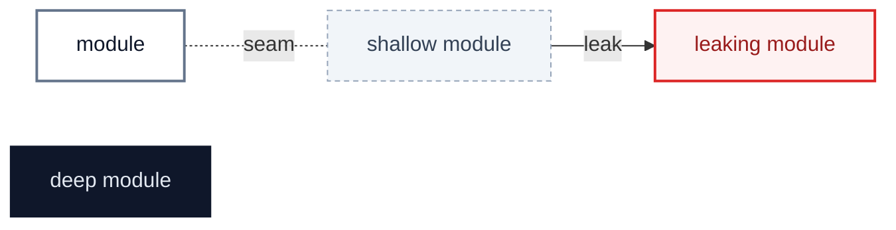
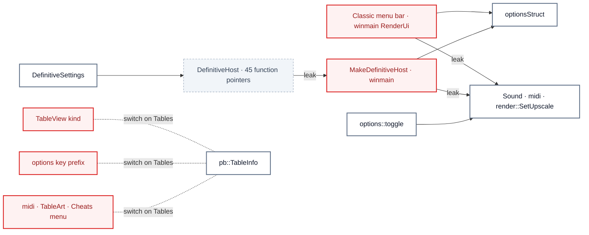

# SpaceCadetPinball: settings and tables have no single home

`2026-11-08` · at `c148d5d` (`main`) · scope: the 3-month churn hot spots (`winmain.cpp` 101 commits, `options.*`, `pb.*`, `Definitive*.cpp`, `render.*`, `TableView.*`, the bonus tables' rules), weighted to fork-added code · glossary: `GLOSSARY.md` · ADRs read: none exist · no `file-tokens` check, so files over ~1,000 lines are size pointers

**Jump to:** [Status](#status) · [Where it hurts](#where-it-hurts) · [Smaller findings](#smaller-findings) · [Recommendation](#recommendation) · cards: [C1](C1-apply-settings.md) · [C2](C2-table-catalog.md) · [C3](C3-table-choices.md) · [C4](C4-hi-frame.md) · [C5](C5-edition-presentation.md) · [C6](C6-bonus-rules-core.md)

Legend

## Status

The backlog, in rank order. After the scan only three parts of the report change: this table, each card's **Decisions**, and **Departures**. The findings stay as found.

| ID | Deepening | Strength | Door | Lens | Status | Branch | PR | Breaking | Notes |
|---|---|---|---|---|---|---|---|---|---|
| [C1](C1-apply-settings.md) | Apply each setting in one place | 🟢 Strong | ↔ two-way | deepening | pr-open | `refactor/apply-settings` | [#172](https://github.com/simonsteiner/SpaceCadetPinball/pull/172) | no | batch 1 of 3 |
| [C2](C2-table-catalog.md) | Let `TableInfo` carry every per-table fact | 🟢 Strong | ↔ two-way | deepening | todo | `refactor/table-catalog` | | | batch 2 of 3 |
| [C3](C3-table-choices.md) | One table-choice module for both pickers | 🟢 Strong | ↔ two-way | deepening | todo | `refactor/table-choices` | | | batch 3 of 3; builds on C2 |
| [C4](C4-hi-frame.md) | Paint the 1x and Hi frames as a pair | 🟡 Worth exploring | ↔ two-way | deepening | todo | `refactor/hi-frame` | | | |
| [C5](C5-edition-presentation.md) | Ask the edition, not the option | 🟡 Worth exploring | ↔ two-way | maintainability | todo | `refactor/edition-presentation` | | | |
| [C6](C6-bonus-rules-core.md) | Share the bonus tables' rules machinery | ⚪ Speculative | ↔ two-way | maintainability | todo | `refactor/bonus-rules-core` | | | |
| [S1](#s1--the-definitive-host-adapter-lives-in-winmaincpp) | The Definitive host adapter lives in `winmain.cpp` | — | ↔ two-way | maintainability | todo | `refactor/definitive-host-file` | | | own PR |
| [S2](#s2--classics-upscaled-art-size-bypasses-the-option-setter) | Classic's Upscaled Art Size bypasses the option setter | — | ↔ two-way | maintainability | pr-open | rides with C1 | | | |
| [S3](#s3--space-cadet-2026-drives-settings-through-classics-menu-ids) | Space Cadet 2026 drives settings through Classic's menu ids | — | ↔ two-way | maintainability | pr-open | rides with C1 | | | |
| [S4](#s4--options-lists-the-bonus-tables-by-hand) | `options` lists the bonus tables by hand | — | ↔ two-way | maintainability | todo | rides with C2 | | | |
| [S5](#s5--classics-cheats-menu-repeats-the-rules-cheat-words) | Classic's Cheats menu repeats the rules' cheat words | — | ↔ two-way | maintainability | todo | rides with C2 | | | |

Strength: 🟢 Strong · 🟡 Worth exploring · ⚪ Speculative · 🔴 live defect (a bug reproduced during the scan).
Door: ↔ two-way (a revert undoes it) · 🚪 one-way (a data migration, a published wire or file format, deleted user data; stops at Step 6 for the user).
Status: `todo` · `in-progress` · `pr-open` · `merged` · `blocked` · `dropped`. `blocked` and `dropped` always carry a reason in Notes.

## Where it hurts

`winmain.cpp` took 101 commits in three months and grew from upstream's 1,416 lines to 2,826. A setting's side effect is written out in up to four places, and adding Skulduggery touched 21 files.

## Smaller findings

### S1 · The Definitive host adapter lives in `winmain.cpp`

`SpaceCadetPinball/winmain.cpp:373-548` · own PR

`MakeDefinitiveHost` is the one adapter behind `DefinitiveHost`: 176 lines of lambdas inside a 2,826-line file that also holds startup, the frame loop, input and Classic's menus. Move it to its own file beside `DefinitiveFrontEnd`, leaving `winmain` one call to make it.

### S2 · Classic's Upscaled Art Size bypasses the option setter

`SpaceCadetPinball/winmain.cpp:1393-1400` · rides with C1

The factor menu sets `Options.UpscaleFactor` and calls `render::SetUpscale` itself, a fourth copy of the rule `options::toggle` and `MakeDefinitiveHost` already hold. It goes through C1's single setter instead.

### S3 · Space Cadet 2026 drives settings through Classic's menu ids

`SpaceCadetPinball/DefinitiveSettings.cpp:347` · rides with C1

`DefinitiveSettings` flips Upscaled Art by calling `options::toggle(Menu1::WindowUpscaledArt)`, so Classic's menu command ids are its vocabulary for a setting, while its sliders go through `DefinitiveHost` setters instead. Both routes become C1's one.

### S4 · `options` lists the bonus tables by hand

`SpaceCadetPinball/options.cpp:812-843` · rides with C2

`TableKeyPrefix` switches over `Tables`, and `TableKeyPrefixToRead` spells `DragonsKeep || Skulduggery` though `pb::BonusTable()` exists. The prefix and the "never saved unprefixed keys" fact belong in `TableInfo`.

### S5 · Classic's Cheats menu repeats the rules' cheat words

`SpaceCadetPinball/winmain.cpp:1600-1610` · rides with C2

The menu lists `1max`, `nmax`, `gmax` and `quote` per bonus table, words each table's rules file already owns. The list comes from the loaded table's rules instead, so the menu has one branch.

## Recommendation

> [!IMPORTANT]
> **Start with [C1 · Apply each setting in one place](C1-apply-settings.md)**: it has the most copies of one rule across both editions' menus, and every new setting pays for it again.
>
> **Proposed batch** (every 🟢 Strong, in order): C1 → C2 → C3

## Departures

<!-- filled during implementation: where a PR deliberately differs from this report, and why -->
